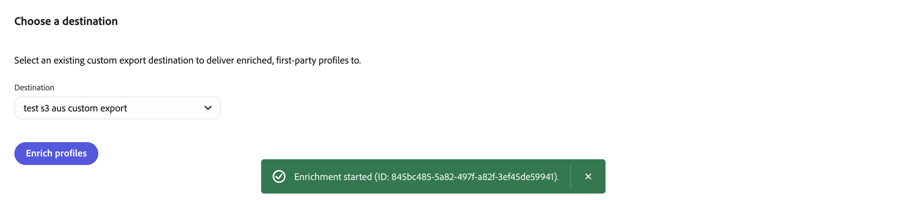

# Enrichissement du profil Trade Desk (Alpha)

Utilisez le flux de données des journaux d’impressions de flux de données d’événement brut (REDS) de [!DNL The Trade Desk] pour exporter des attributs d’enrichissement et un contexte de média payant vers vos profils propriétaires.

Une fois le fichier CSV arrivé dans votre destination d’exportation [!DNL Amazon S3], ingérez-le dans [!DNL Adobe Real-Time CDP]. Dans cette version, l’exportation du fichier ne met pas automatiquement à jour les profils ni n’active les expériences. L’enrichissement automatisé du profil sur [!DNL Adobe Real-Time CDP] sera une fonctionnalité dans une version ultérieure.

L’exposition aux annonces ajoute du contexte aux profils des clients. Elle ne confirme pas l’engagement, l’intention d’achat ou les intérêts à long terme.

## Préparation à l’enrichissement {#prepare-for-enrichment}

Avant de commencer, collaborez avec votre administrateur, votre équipe des médias et votre équipe des données pour vous assurer que vous disposez des éléments suivants :

* Accès à [!DNL Adobe Real-Time CDP Collaboration] et accord de participation signé.
* Une lettre d&#39;accès complétée avec [!DNL The Trade Desk] pour autoriser l&#39;approvisionnement du flux REDS.
* Audiences propriétaires disponibles dans [!DNL Adobe Real-Time CDP Collaboration] qui utilisent des adresses e-mail ou des numéros de téléphone hachés. Les autres identifiants ne sont pas pris en charge dans cette version.
* Une destination [!DNL Amazon S3] configurée pour recevoir une sortie d’enrichissement.
* Processus d’ingestion du fichier diffusé dans [!DNL Adobe Real-Time CDP].

### Autoriser le flux source {#authorize-source-feed}

Remplissez la lettre d’accès fournie par [!DNL The Trade Desk] pour autoriser [!DNL The Trade Desk] à envoyer directement les journaux REDS à Adobe.

[!DNL The Trade Desk] approvisionne le flux source et Adobe configure l’accès et l’ingestion. Avant de créer un projet, vérifiez que la connexion est active et que le flux est prêt.

Après le traitement, le fichier de sortie d’enrichissement arrive dans votre destination d’exportation.

### Préparation de l’ingestion en aval {#prepare-downstream-ingestion}

Après la diffusion, demandez à votre administrateur [!DNL Adobe Real-Time CDP] ou à votre équipe d’assistance technique d’ingérer le fichier.

## Connexion et création de projets {#connect-create-projects}

Renseignez la lettre d’accès dans la boîte de dialogue de connexion et enregistrez votre identifiant partenaire. Attendez qu’Adobe confirme la réception de vos journaux REDS avant de créer un projet. La création d’un projet lance la tâche d’enrichissement, qui nécessite votre identifiant partenaire et les journaux.

### Se connecter avec le partenaire {#connect-partner}

Connectez-vous à [!DNL The Trade Desk] et ajoutez les informations de votre annonceur :

1. Dans **[!UICONTROL Connexion]**, ouvrez **[!UICONTROL Découvrir les collaborateurs]**.
1. Recherchez [!DNL The Trade Desk].
   ![Le catalogue des collaborateurs répertorie [!DNL The Trade Desk] et son option [!UICONTROL Connexion].](../../../assets/collaborate/advertising-platforms/discover-collaborators-trade-desk.png){zoomable="yes"}
1. Sélectionnez **[!UICONTROL Connexion]** pour [!DNL The Trade Desk] et suivez les instructions de la boîte de dialogue de connexion.
   ![La boîte de dialogue de connexion explique l’autorisation REDS et la configuration de l’ID de partenaire pour [!DNL The Trade Desk].](../../../assets/collaborate/advertising-platforms/trade-desk-connection-instructions.png){zoomable="yes"}
1. Une fois la connexion active, ouvrez **[!UICONTROL Paramètres de connexion]**. Dans **[!UICONTROL Informations sur l’annonceur]**, sélectionnez **[!UICONTROL Modifier]** pour mettre à jour les informations existantes ou **[!UICONTROL Ajouter]** pour saisir de nouvelles informations.
   ![Les paramètres de connexion actifs affichent [!UICONTROL Informations sur l’annonceur] et la commande [!UICONTROL Modifier].](../../../assets/collaborate/advertising-platforms/trade-desk-connection-settings.png){zoomable="yes"}
1. Saisissez votre ID de partenaire et votre nom de partenaire dans **[!UICONTROL ID de partenaire]** et **[!UICONTROL Nom de partenaire]**, puis sélectionnez **[!UICONTROL Enregistrer]**. Recherchez votre ID de partenaire dans votre compte [!DNL The Trade Desk] sous **[!UICONTROL Identifiants de places]**.
   ![La boîte de dialogue Informations sur l’annonceur comporte des champs d’ID de partenaire et de nom de partenaire obligatoires, ainsi qu’un contrôle [!UICONTROL Enregistrer].](../../../assets/collaborate/advertising-platforms/trade-desk-advertiser-partner-info-dialog.png){zoomable="yes"}

Une fois la connexion établie et les informations de l’annonceur enregistrées, attendez la confirmation qu’Adobe a bien reçu vos journaux REDS. Créez ensuite un projet.

### Créer un projet {#create-project}

Créez un projet pour la connexion :

1. Dans **[!UICONTROL Collaborer]**, sélectionnez **[!UICONTROL Mes projets]**.
1. Sélectionnez **[!UICONTROL Créer un projet]** ou l’icône Ajouter ().
1. Dans **[!UICONTROL Créer un projet]**, sélectionnez [!DNL The Trade Desk] dans **[!UICONTROL Collaborateur]**.
   ![Le formulaire [!UICONTROL Créer un projet] répertorie [!DNL The Trade Desk] et inclut le nom, la description et les champs d’image du projet.](../../../assets/collaborate/advertising-platforms/trade-desk-create-project.png){zoomable="yes"}
1. Saisissez un **[!UICONTROL nom de projet]** et une **[!UICONTROL description]**, puis choisissez une image pour identifier le projet.
1. Sélectionnez **[!UICONTROL Créer]**.

Pour la gestion générale des projets, consultez le [guide Créer et gérer des projets](/help/guide/collaborate/manage-projects.md).

## Sélectionner et exporter des attributs {#select-export-attributes}

Exportez les attributs d’enrichissement de votre projet :

<!-- TODO: Replace the destination screenshot with one showing the [!UICONTROL Export Attributes] action. -->

1. Ouvrez le projet et sélectionnez **[!UICONTROL Enrichir]**.
1. Examinez les valeurs de couverture pour chaque attribut afin de comprendre la disponibilité du signal.
1. Sélectionnez les attributs à utiliser pour l’enrichissement.
   ![La page [!UICONTROL Enrichir] regroupe les signaux sélectionnables par catégorie et affiche les valeurs de couverture.](../../../assets/collaborate/advertising-platforms/enrich-attribute-selection.png){zoomable="yes"}
1. Sélectionnez la destination d&#39;exportation [!DNL Amazon S3] configurée pour la sortie d&#39;enrichissement. Pour configurer une destination, consultez [Configurer et gérer des destinations d’espace de stockage](/help/guide/destinations/manage-destinations.md).
   <!-- ![The [!UICONTROL Choose a destination] screen lists a destination and the [!UICONTROL Export Attributes] action.](../../../assets/collaborate/advertising-platforms/enrich-choose-destination.png){zoomable="yes"} -->
1. Vérifiez les attributs et la destination sélectionnés, puis sélectionnez **[!UICONTROL Exporter les attributs]**.
   <!-- {zoomable="yes"} -->

L’envoi d’une exportation démarre la diffusion si la destination est correctement configurée. Vérifiez la réussite de la diffusion des fichiers en dehors de [!DNL Adobe Real-Time CDP Collaboration].

Adobe traite les attributs d’enrichissement lors de la création d’un projet, puis une fois par semaine. Chaque exécution utilise les 90 derniers jours de données [!DNL The Trade Desk] disponibles. Chaque exportation inclut les attributs sélectionnés de l’exécution terminée la plus récente. Pour exporter des attributs actualisés, demandez une autre exportation une fois une exécution ultérieure terminée.

### Signaux d’enrichissement disponibles {#available-signals}

Sélectionnez parmi 18 signaux traités dans quatre catégories. Les expressions d’enrichissement personnalisées ne sont pas prises en charge.

| Catégorie | Signal | Description |
| --- | --- | --- |
| Base | [!UICONTROL Date de la dernière exposition] | Date à laquelle une identité a été exposée le plus récemment à une publicité. |
| Base | [!UICONTROL Nombre d’expositions] | Catégorie de fréquence d’exposition, plutôt que nombre d’impressions brutes. |
| Base | [!UICONTROL Prospection et reciblage] | Classification inférée de l&#39;exposition en tant que prospection ou remarketing. |
| Base | [!UICONTROL Catégorie de produits affichée] | Catégorie déduite pour les produits promus dans les publicités. |
| Base | [!UICONTROL Canal d’inventaire dominant] | Canal d’inventaire principal associé à l’exposition publicitaire. |
| Base | [!UICONTROL Type d’appareil dominant] | Type d’appareil principal associé à l’exposition publicitaire. |
| Géographie | [!UICONTROL Ville] | Informations sur la ville provenant du contexte publicitaire, et non d’un emplacement vérifié. |
| Géographie | [!UICONTROL Région/État] | Informations sur la région ou l’état à partir du contexte publicitaire. |
| Géographie | [!UICONTROL DMA] | Informations relatives aux zones de marché désignées (DMA) provenant du contexte publicitaire. |
| Télévision connectée (CTV) | [!UICONTROL CTV exposé] | Exposition publicitaire sur un appareil de télévision connecté. |
| Télévision connectée (CTV) | [!UICONTROL Visionneuse de flux en direct] | Exposition des publicités dans l’inventaire en direct, et non preuve d’affichage ou d’engagement. |
| Télévision connectée (CTV) | [!UICONTROL Exposition PMP/premium] | Exposition au risque de marché privé (PMP) ou de contrat privé, non vérifiée de façon indépendante. |
| Affinité du contenu | [!UICONTROL Télévision connectée/diffusion en continu] | Exposition des publicités associée au contenu en flux continu. |
| Affinité du contenu | [!UICONTROL Joueur] | Exposition publicitaire associée au contenu, aux sites ou aux applications de jeux. |
| Affinité du contenu | [!UICONTROL Fan de sport] | Exposition publicitaire associée au contenu, aux sites ou aux applications sportifs. |
| Affinité du contenu | [!UICONTROL Abonné aux actualités] | Exposition publicitaire associée au contenu d’actualités, aux sites ou aux applications. |
| Affinité du contenu | [!UICONTROL Amoureux de la musique] | Exposition publicitaire associée au contenu musical, aux sites ou aux applications. |
| Affinité du contenu | [!UICONTROL Genre de contenu] | Genre de contenu associé à l’exposition publicitaire. |

Les signaux géographiques décrivent le contexte publicitaire plutôt qu&#39;une maison vérifiée ou un emplacement actuel. Les signaux d’affinité de contenu ne confirment pas les intérêts ou préférences personnels. Certains attributs peuvent ne pas contenir de valeurs lorsque les informations sources ne sont pas disponibles.

### Couverture des attributs {#attribute-coverage}

La couverture décrit la fréquence à laquelle les enregistrements traités incluent une valeur d’attribut. Pour les signaux oui/non, tels que **[!UICONTROL CTV exposé]**, la couverture comptabilise les enregistrements avec une valeur vraie. La couverture n’indique pas les taux de correspondance d’identité ou la proportion de profils propriétaires qui recevront un attribut.

La correspondance des identités, la disponibilité du signal source et l’ingestion affectent les mises à jour des profils. La couverture ne confirme pas la fin de l’exportation ou les mises à jour du profil.

### Portée du workflow {#workflow-scope}

Utilisez le catalogue traité pour enrichir les données de [!DNL The Trade Desk]. Vous ne pouvez pas exporter de journaux bruts ni créer d’expressions d’attribut personnalisées. Les autres intégrations de plateforme côté demande (DSP) et de plateforme côté offre (SSP) ne sont pas prises en charge.

Ce workflow ne prend pas en charge la découverte d’opportunité d’enrichissement, l’analyse de chevauchement des audiences ou la mesure d’attribution et d’incrémentalité.

## Ingérer et valider des résultats {#ingest-validate-results}

Après la diffusion, demandez à votre administrateur [!DNL Adobe Real-Time CDP] ou à votre équipe d’assistance technique d’ingérer le fichier.

### Fichier de sortie {#output-file}

L’exportation diffuse un fichier CSV vers la destination [!DNL Amazon S3] configurée.

<!-- 
TODO: replace this placeholder with the engineering-confirmed output specification:
* Required hashing and normalization for each identifier, including whether email requires SHA-256 after trimming and lowercasing.
* Exact CSV headers, the file naming pattern, and the delivery bucket and path.
* Each identifier column in the delivered file and the identity namespace to map that column to during ingestion.
Do not treat example formats or supported input match keys as confirmed output requirements.
-->

Vérifiez l’exportation séparément des mises à jour de profil :

1. Vérifiez que le fichier CSV est arrivé à l’emplacement prévu [!DNL Amazon S3].
1. Vérifiez que le fichier contient les identifiants attendus et les attributs sélectionnés.
1. Ingérez le fichier à l’aide des mappages d’identité et de schéma confirmés pour le sandbox et le jeu de données cibles.
1. Passez en revue les résultats de l’ingestion et vérifiez qu’un échantillon des profils attendus contient les attributs d’enrichissement.

L’exportation d’un fichier ne confirme pas la mise à jour des profils par ingestion. Ingérez chaque exportation ultérieure séparément pour mettre à jour les profils.

## Résolution des problèmes d’enrichissement {#troubleshoot-enrichment}

Utilisez ces vérifications pour résoudre les problèmes liés aux données sources, à l’exportation et à l’ingestion :

| Problème | Éléments à vérifier |
| --- | --- |
| La connexion ou **[!UICONTROL Enrichir]** n&#39;est pas disponible | Demandez à votre administrateur de confirmer votre connexion et l’accès au projet. Vérifiez que la configuration du flux source est terminée. |
| Aucune destination d’exportation disponible | Demandez à votre administrateur de confirmer qu’une destination est configurée et disponible pour la sortie d’enrichissement. |
| Un attribut a une couverture limitée | Vérifiez la disponibilité des données sources avec votre équipe des médias. N’interprétez pas la couverture comme un taux de correspondance de profil. |
| Une exportation a été demandée, mais aucun fichier n’est présent | Vérifiez la destination prévue avec votre équipe de données. La soumission de la demande ne confirme pas la diffusion. |
| Un fichier diffusé n’a pas mis à jour de profil | Passez en revue les résultats de l’ingestion et confirmez les mappages d’identité et de schéma. L’exportation et l’ingestion sont des opérations distinctes. |
| Vous ne pouvez pas demander d’exportation | Sélectionnez au moins un attribut et une destination. Si une exportation est déjà en cours de traitement, attendez qu’elle se termine avant de demander une autre exportation. |
| La couverture est élevée, mais peu de profils reçoivent des attributs | La couverture n’est pas un taux de correspondance d’identité. Vérifiez que le flux source est prêt, que l’audience utilise les clés de correspondance prises en charge et que votre mappage d’identité est correct lors de l’ingestion. |
| Aucun attribut ni aucune couverture n’apparaissent après la création d’un projet | La configuration du projet est corrigée lors de sa création. Si Adobe n&#39;avait pas reçu vos journaux REDS de [!DNL The Trade Desk] à ce moment-là, le projet ne peut pas les utiliser ultérieurement. Une fois qu’Adobe a confirmé la réception de vos journaux, créez un projet. |
| Les profils possèdent les attributs, mais une audience ou une expérience ne les reflète pas | Vérifiez les règles de ciblage d’évaluation d’audience, d’identité, de consentement et d’expérience en aval. |

## Étapes suivantes {#next-steps}

Après avoir ingéré et validé les attributs, créez des audiences dans [!DNL Adobe Real-Time CDP] en combinant des signaux d’enrichissement avec des données propriétaires. Pour plus d’informations, consultez le [guide du créateur d’audiences](https://experienceleague.adobe.com/fr/docs/experience-platform/segmentation/ui/audience-builder){target="_blank"}.

Pour activer des audiences pour des destinations, de la personnalisation ou des parcours client, consultez le [guide d’activation des audiences](https://experienceleague.adobe.com/fr/docs/experience-platform/destinations/ui/activate/activation-overview){target="_blank"}.
