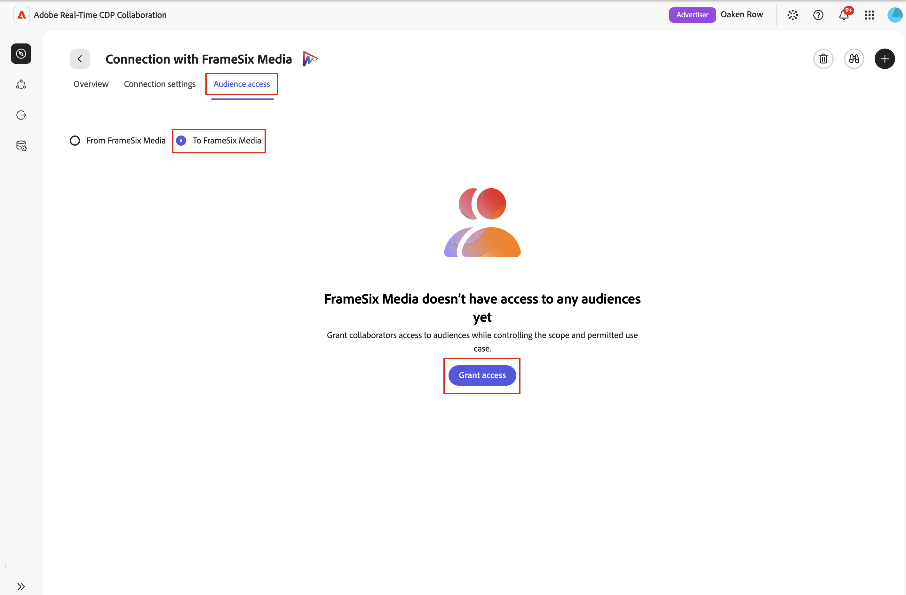

# Accès aux audiences virtuelles (octroi d’audiences) pour RMN {#virtual-audience-access}

Pour partager des audiences avec des partenaires connectés, utilisez l’accès aux audiences virtuelles dans [!DNL Adobe Real-Time CDP Collaboration]. Une autorisation d’audience donne au partenaire l’accès à la population complète d’audience par le biais d’une référence persistante. Vous conservez la propriété et aucune donnée d’audience ne se déplace lorsque vous accordez l’accès.

Pour utiliser une audience partagée, recherchez l’audience virtuelle dans votre inventaire. Utilisez l’audience pour l’activation ou la création d’audience de cohorte dans les autorisations d’octroi. Par exemple, un réseau de médias de vente au détail (RMN) peut accorder aux annonceurs l’accès pour la création et l’activation d’audiences de cohorte.

## Concepts d’accès à l’audience {#audience-access-concepts}

Pour comprendre ce que vous partagez et comment un partenaire peut utiliser l’audience, consultez les termes suivants.

| Terme | Description |
| --- | --- |
| Prestataire | Organisation propriétaire de l’audience et contrôlant l’accès. |
| Destinataire | Partenaire connecté qui reçoit l’accès à l’audience. |
| Subvention | Accès à une audience partagée, y compris les utilisations autorisées et la durée d’accès. |
| Audience virtuelle | Référence persistante à une audience appartenant au fournisseur, disponible dans l’inventaire des destinataires. |
| Population Complète | Partage qui accorde l’accès à l’ensemble de la population de l’audience. |
| Étendue de la connexion | Accès qui s’applique à la connexion entre le fournisseur et le destinataire, plutôt qu’à un seul projet. |

{style="table-layout:auto"}

Pour activer une audience partagée, vous avez besoin d’une autorisation d’activation directe.

L’accès aux audiences virtuelles s’applique à une connexion. Le partage au sein d’un projet est un workflow distinct qui n’ajoute pas les audiences virtuelles à l’inventaire des destinataires.

Pour activer des audiences dans un projet de collaboration existant, consultez [Envoyer et activer des audiences dans un projet](/help/guide/collaborate/activate.md).

## Conditions préalables {#prerequisites}

Avant d’accorder ou d’utiliser l’accès aux audiences virtuelles, vérifiez que vous répondez aux exigences suivantes.

* Pour les subventions d&#39;audience virtuelle, établissez une [connexion active avec votre collaborateur](/help/guide/connect/establishing-connections.md).
* Si vous fournissez une audience, vérifiez qu’elle est disponible pour être partagée.
* Pour confirmer quelles actions sont disponibles, passez en revue les autorisations d’octroi des audiences partagées avec vous.

La boîte de dialogue **[!UICONTROL Partager les audiences]** affiche les autorisations suivantes. Les deux autorisations sont sélectionnées et non modifiables.

| Autorisation Audience | Utilisation autorisée |
| --- | --- |
| Activation directe | Activez une audience partagée vers une destination sans projet lorsque l’audience répond aux exigences d’activation. |
| [!UICONTROL Créer une nouvelle audience] | Utilisez une audience partagée comme entrée lors de la création d’audiences. |

{style="table-layout:auto"}

## Partage d’une audience {#share-an-audience}

Pour permettre à un partenaire connecté d’accéder à des audiences sélectionnées, accordez l’accès à l’ensemble de la population et définissez les utilisations et la durée autorisées. L’octroi de l’accès n’active pas les audiences.

Tout d&#39;abord, ouvrez l&#39;espace de travail **[!UICONTROL Connect]** et la connexion du destinataire.

Ensuite, sélectionnez **[!UICONTROL Accès à l’audience]** et choisissez l’option pour les audiences que vous partagez avec le partenaire.

L’option inclut le nom du partenaire. Dans cet exemple, sélectionnez **[!UICONTROL Pour FrameSix Media]**.

Sélectionnez ensuite **[!UICONTROL Accorder l’accès]** pour ouvrir la boîte de dialogue **[!UICONTROL Partager les audiences]**.

Dans **[!UICONTROL Audiences]**, choisissez les audiences dans **[!UICONTROL Sélectionner des audiences]** ou sélectionner **[!UICONTROL Parcourir les audiences]**.

Les audiences sélectionnées s’affichent dans la boîte de dialogue. Votre entreprise conserve la propriété et la gestion des audiences.

Examinez ensuite les autorisations affichées dans **[!UICONTROL Autorisation]**. L’autorisation Activation directe permet au partenaire d’activer des audiences virtuelles vers ses propres destinations. **[!UICONTROL Créer une nouvelle audience]** permet au partenaire d’utiliser des audiences virtuelles pour créer de nouvelles audiences. Les deux autorisations sont sélectionnées et non modifiables.

Ensuite, choisissez une option parmi **[!UICONTROL Durée]** dans **[!UICONTROL Durée d&#39;accès]** pour définir la durée d&#39;accès du partenaire. Sélectionnez **[!UICONTROL Toujours]** pour l&#39;accès sans date d&#39;expiration ou spécifiez une date pour l&#39;accès limité dans le temps.

Enfin, passez en revue les audiences sélectionnées, les autorisations et la durée d’accès, puis sélectionnez **[!UICONTROL Accorder l’accès]**.

L’onglet **[!UICONTROL Accès à l’audience]** répertorie les audiences partagées avec leur statut, le nombre d’identités, la durée d’accès, les autorisations et la description.

Les audiences partagées apparaissent également dans l’inventaire des destinataires sous la forme de références virtuelles. Vous conservez la propriété. Le destinataire peut activer une audience séparément si l’octroi de la subvention le permet.

## Rechercher et utiliser des audiences partagées {#find-and-use-shared-audiences}

En tant que destinataire, recherchez des audiences partagées dans l’onglet **[!UICONTROL Accès à l’audience]** de la connexion du fournisseur. Utilisez chaque audience dans les autorisations d’octroi.

### Rechercher des audiences partagées {#find-shared-audiences}

Pour rechercher des audiences partagées par un fournisseur et vérifier leurs détails d&#39;accès, ouvrez la connexion du fournisseur. Tout d&#39;abord, ouvrez l&#39;espace de travail **[!UICONTROL Connect]** et la connexion du fournisseur.

Sélectionnez ensuite **[!UICONTROL Accès à l’audience]** et choisissez l’option pour les audiences partagées par le fournisseur.

L’option inclut le nom du fournisseur. Dans cet exemple, sélectionnez **[!UICONTROL À partir du média FrameSix]**.

Enfin, passez en revue les audiences partagées et leurs détails d’accès.

### Créer des audiences {#build-audiences}

Pour créer une audience à partir d’une audience partagée, vous avez besoin de l’autorisation **[!UICONTROL Créer une nouvelle audience]**. Par exemple, combinez une audience partagée avec votre propre audience pour créer une nouvelle audience.

La nouvelle audience vous appartient. Le fournisseur conserve la propriété de l’audience source.

### Activer les audiences partagées {#activate-shared-audiences}

Pour l’activation directe d’une audience virtuelle, vérifiez que la subvention remplit ces conditions.

| Exigence | Condition |
| --- | --- |
| Type de partage | Population Complète |
| Autorisation Audience | Vous disposez d’une autorisation d’activation directe pour l’audience. |
| Statut d’octroi | Actif. L’accès est indéfini ou se situe dans la période spécifiée. |

{style="table-layout:auto"}

Pour envoyer une audience éligible vers une destination, utilisez la page **[!UICONTROL Activer]**. Vous n’avez pas besoin de projet.

Pour plus d&#39;informations, voir [Activer les audiences directement (Beta)](/help/guide/destinations/direct-audience-activation.md).

Si une audience ne répond pas aux exigences, vous ne pouvez pas la sélectionner pour une activation directe. Collaboration vérifie à nouveau l’éligibilité à chaque exécution d’activation planifiée.

## Gérer l’accès aux audiences {#manage-audience-access}

En tant que fournisseur, vous contrôlez la durée de l’accès. Vous seul pouvez modifier l’expiration de l’octroi ou révoquer l’accès.

### Durée de l’accès {#access-duration}

Choisissez une durée d’accès lors de la création de l’octroi.

| Durée | Comportement |
| --- | --- |
| [!UICONTROL Toujours] | Access n’a pas d’expiration automatique. Vous pouvez révoquer la subvention. |
| Période | L’accès dure pendant la période spécifiée. Collaboration traite l’expiration toutes les heures. |

{style="table-layout:auto"}

Pour prolonger l’accès, définissez une date d’expiration ultérieure ou définissez la durée sur un accès indéfini. L’une ou l’autre des modifications réactive également une subvention expirée.

### Expiration de l’accès {#access-expiration}

Collaboration vérifie les octrois expirés toutes les heures. Lorsque Collaboration marque une subvention comme ayant expiré, le destinataire perd l’accès virtuel à l’audience.

### Révoquer l’accès {#revoke-access}

Pour supprimer immédiatement l’accès virtuel, révoquez l’octroi actif ou expiré.

## Étapes suivantes {#next-steps}

Après avoir accordé ou reçu l’accès à l’audience, utilisez les guides suivants pour préparer l’activation ou gérer les connexions des collaborateurs.

* [Configuration et gestion des destinations](/help/guide/destinations/manage-destinations.md)
* [Gérer les connexions des collaborateurs](/help/guide/connect/manage-connections.md)
